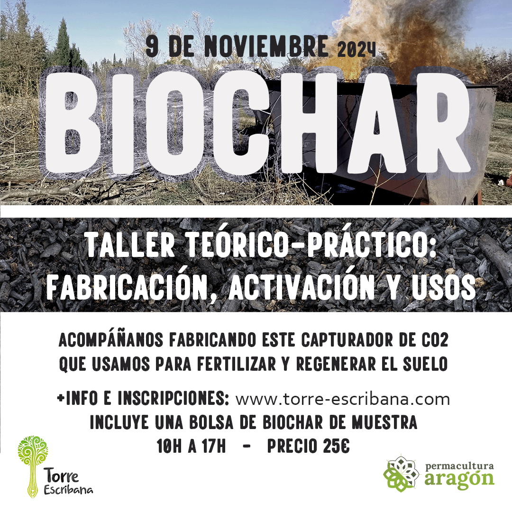
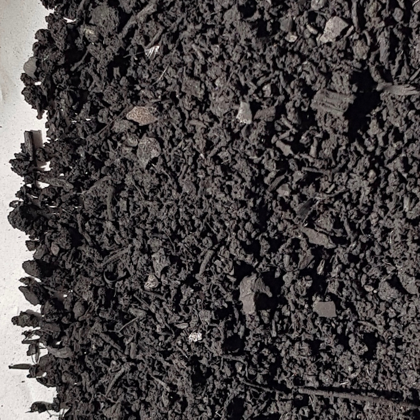

## ¿Qué es el Biochar?
El **Biochar** es una forma de carbón creado calentando biomasa, como residuos agrícolas, astillas de madera o residuos de cultivos, en un entorno de bajo contenido de oxígeno a través de un proceso llamado **pirólisis.** Se activa invitando a **millones de microorganismos** a establecerse en los huecos que tiene su estructura.

El biochar posee propiedades extraordinarias que tienen un inmenso potencial para el **almacenamiento de carbono**, mejorar la salud del suelo y los árboles, y aumentar los rendimientos de los cultivos para los agricultores. 

En este taller práctico os enseñaremos cómo **lo fabricamos, lo activamos y lo usamos** en   Torre Escribana. .

 

**Lugar:** Torre Escribana - Montañana - Zaragoza (te mandaremos ubicación exacta)  
**Hora Comienzo:** 10:00  
**Hora Final:** 17:00  
**Comida:** de traje (para compartir si quieres)  
**Obsequio:** 1 bolsa de unos 10 litros de Biochar.  

{: .box-success}
Para pedir más información escríbenos a **torreescribana (arroba) gmail.com**

El taller está supeditado al tiempo que haga. Si se tiene que cancelar se trasladará a otro día y se devolverá el coste si en esa fecha no tuvieras disposición. 

 