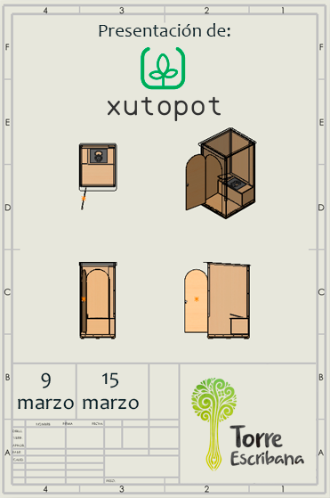

### El wc seco 100% ecológico para campamentos y eventos al aire libre

Una experiencia exclusiva para grupos scouts y clubes de tiempo libre

📅 Elige tu fecha y acompáñanos en una visita especial a Torre Escribana, donde presentaremos Xutopot, la solución sostenible e innovadora para tus actividades al aire libre.
🎁 Beneficio exclusivo: Por asistir, obtendrás un 10% de descuento adicional en tu primer pedido, válido para este verano.

🌟 Qué te espera:
Presentación del producto.
Visita corta a las instalaciones.
Resolución de dudas y consejos para tus campamentos.

🚀 ¡No te quedes fuera!
Plazas limitadas, accede al formulario para elegir tu fecha y asegurar tu invitación:

 

**Xutopot** es un baño seco portátil y ecológico diseñado para actividades al aire libre como campamentos, festivales y eventos. Este innovador sistema no utiliza químicos, es fácil de montar y transportar, y contribuye a la **sostenibilidad y el cuidado del medioambiente.**

Xutopot separa automáticamente los sólidos de los líquidos mediante un separador. A los sólidos se le añade un secante para evitar olores y los líquidos se almacenan en un recipiente. Los dos productos por separado pueden utilizarse como fertilizante con un tratamiento adecuado.

**Lugar:** Torre Escribana - Montañana - Zaragoza (te mandaremos ubicación exacta)  
**Hora Comienzo:** 10am  
**Hora Final:** 12am 

{: .box-success}
Para pedir más información escríbenos a **infoxutopot (arroba) gmail.com**

 