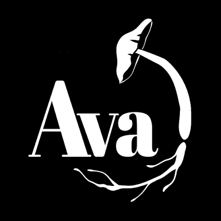

Los hongos son mucho más que setas: son los grandes conectores de la vida bajo nuestros pies.

## Cultivo de setas en exterior

### Una jornada para conocer, experimentar y aprender a cultivar hongos

Los hongos son fundamentales para la vida del suelo: descomponen materia orgánica, reciclan nutrientes y establecen relaciones de simbiosis con las plantas. Pero además, ¡podemos aprender a cultivarlos!

En este **taller teórico-práctico** descubriremos cómo viven y se desarrollan los hongos, aprenderemos técnicas de micocultivo que podemos reproducir en casa y exploraremos su importancia para la fertilidad del suelo y la regeneración de los ecosistemas.

  

    <strong>Una jornada organizada conjuntamente por Torre Escribana y AVA</strong>
  

  

  

    <a href="https://www.avacoop.com/" target="_blank" rel="noopener noreferrer">Conoce AVA</a>
  

## ¿Qué aprenderemos?

### Por la mañana: Micelio, sustratos y vida del suelo

**Conociendo a los hongos**

Descubriremos cómo se comportan, cómo se alimentan y qué condiciones necesitan para desarrollarse y poder cultivarlos.

**Aislamiento de micelio**

Realizaremos una práctica de aislamiento de micelio con técnicas caseras y materiales accesibles para comprender las bases del micocultivo.

**Preparación de sustratos y siembra**

Aprenderemos a preparar un sustrato adecuado y a inocularlo con un hongo. Cada participante preparará su propio bloque de cultivo, que podrá llevarse a casa para incubarlo durante las siguientes semanas.

**Los hongos en el suelo**

Exploraremos las relaciones de simbiosis entre hongos y plantas, sus funciones ecosistémicas y las estrategias para favorecer los organismos beneficiosos del suelo.

### Por la tarde: Cultivo tradicional en troncos

**Cultivo de hongos sobre madera**

Aprenderemos las técnicas tradicionales de cultivo en troncos y ramas, desde la selección de la madera hasta su inoculación. Realizaremos una práctica de siembra de micelio en ramas.

**Estimulación de las cosechas**

Conoceremos las condiciones de incubación, los cuidados necesarios y las estrategias para estimular la aparición de setas y favorecer nuevas cosechas.

## ¿Qué te llevarás?

- Un bloque de sustrato inoculado para incubarlo en casa.
- Experiencia práctica en aislamiento de micelio y cultivo sobre madera.
- Conocimientos para iniciar tus propios cultivos de setas.
- Estrategias para favorecer los hongos beneficiosos en el suelo.

## Información del taller

**Lugar:** Torre Escribana — Montañana, Zaragoza.

**Fecha:** Sábado 12 de diciembre de 2026.

**Duración:** Jornada de mañana y tarde.

**Precio general:** 85 € por persona.

**Precio reducido:** 70 € para personas desempleadas o en situación de vulnerabilidad.

**Organizan:** Torre Escribana y [AVA](https://www.avacoop.com/).

### ¿A quién va dirigido?

A cualquier persona interesada en el cultivo de setas, la permacultura, la agroecología o la vida del suelo. **No es necesario tener conocimientos previos**, solo ganas de aprender y experimentar.

## Inscripciones

Si quieres participar en esta jornada, completa el siguiente formulario de inscripción.

<iframe
  src="https://docs.google.com/forms/d/e/1FAIpQLScsb_t0L3lcverL8k63fGPQQfnmF5sB6Ntnsl3Tezd4lGw41w/viewform?embedded=true"
  width="100%"
  height="1400"
  frameborder="0"
  marginheight="0"
  marginwidth="0"
  style="border:0; max-width:100%;">
  Cargando formulario…
</iframe>

  Si no puedes visualizar el formulario,
  <a href="https://forms.gle/Cdbj486s7czccxGu8" target="_blank" rel="noopener noreferrer">
    puedes abrirlo directamente aquí.
  </a>

