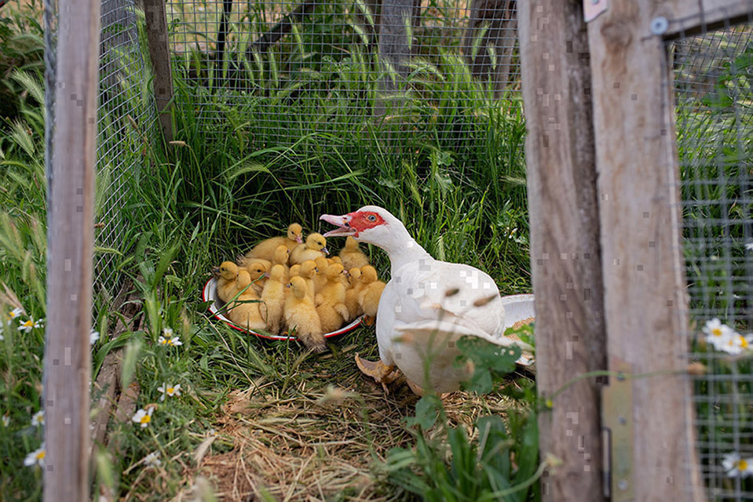

Las aves forman parte de muchos sistemas agrícolas: exploran el terreno, comen semillas e invertebrados y producen estiércol que puede aprovecharse con un manejo adecuado. Observar su comportamiento ayuda a entender cómo se relacionan con el suelo, las plantas y el agua.

Integrarlas en un diseño requiere atender primero sus necesidades: alimento, agua, refugio, espacio y protección. Su acceso al huerto o a determinadas zonas debe planificarse para cuidar tanto a los animales como a los cultivos.

Una visita permite conocer a las aves de la finca y conversar sobre sus cuidados y las funciones que pueden cumplir dentro del conjunto.

<figure class="ficha-foto"></figure>

<a href="{{ '/visitas/' | relative_url }}" class="btn-te">Descúbrelo en una visita</a>

