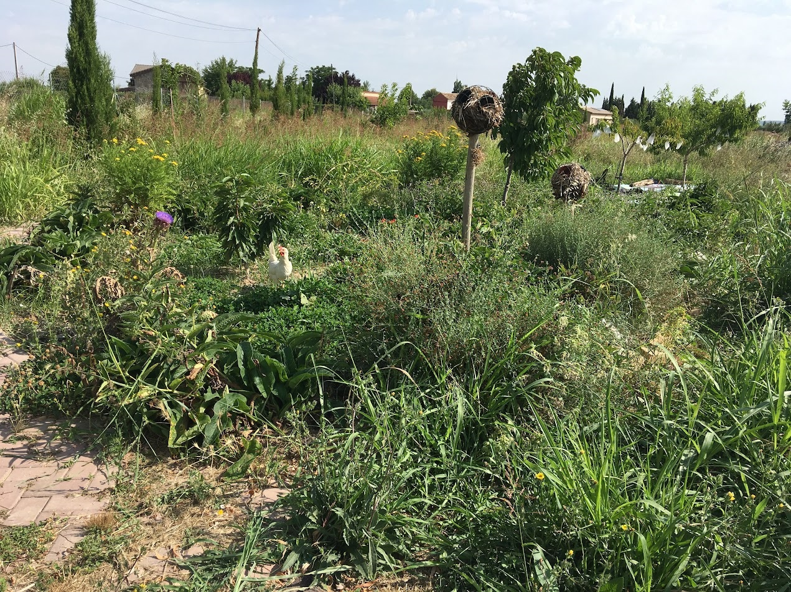

Un bosque comestible combina árboles, arbustos y plantas de diferentes alturas para producir alimentos y otros recursos. Se inspira en las relaciones de un bosque y se adapta al clima, al suelo y al agua disponible en cada lugar.

La elección de especies y su distribución buscan complementar funciones: dar sombra, cubrir el suelo, ofrecer floración para insectos o aportar materia orgánica. El sistema cambia con los años y necesita observación, riego y cuidados acordes a su etapa.

En una visita podemos mirar estas relaciones sobre el terreno y descubrir por qué diseñar un bosque comestible va mucho más allá de plantar frutales.

<figure class="ficha-foto"></figure>

<a href="{{ '/visitas/' | relative_url }}" class="btn-te">Descúbrelo en una visita</a>

