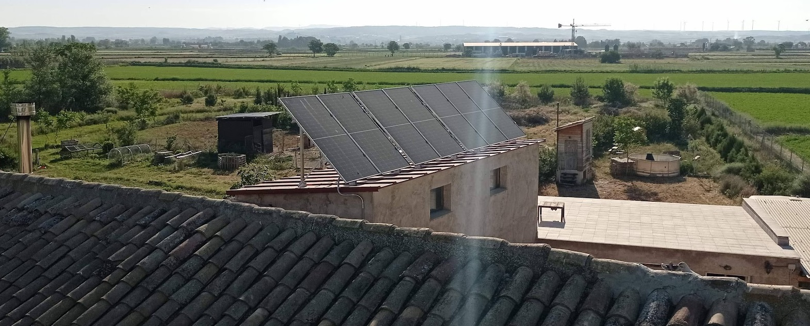

La gestión de la energía comienza por conocer para qué la necesitamos y cómo podemos reducir los consumos evitables. A partir de ahí, la producción renovable puede cubrir parte de las necesidades de una vivienda o una finca.

En un diseño permacultural importa tanto la fuente de energía como el momento en que se utiliza. Ajustar ciertos usos a la producción disponible y observar los consumos ayuda a aprovechar mejor los recursos.

Los paneles solares de Torre Escribana son un punto de partida para conversar durante las visitas sobre energía, hábitos y autonomía.

<figure class="ficha-foto"></figure>

<a href="{{ '/visitas/' | relative_url }}" class="btn-te">Descúbrelo en una visita</a>

