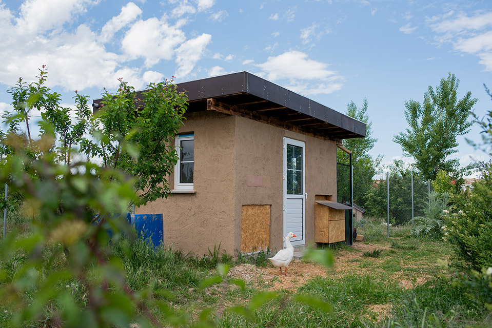

Un gallinero es el refugio de las gallinas y un espacio que necesita ventilación, protección y facilidad de limpieza. Su diseño debe permitir descansar, poner huevos y acceder con seguridad al alimento y al agua.

La ubicación y los materiales influyen en el confort de las aves y en el trabajo de quienes las cuidan. También conviene pensar cómo se gestionan las camas y el estiércol, y qué relación tiene el gallinero con las zonas de cultivo.

Durante la visita podemos conocer este espacio y comentar cómo un elemento cotidiano se conecta con el resto de la finca.

<figure class="ficha-foto"></figure>

<a href="{{ '/visitas/' | relative_url }}" class="btn-te">Descúbrelo en una visita</a>

