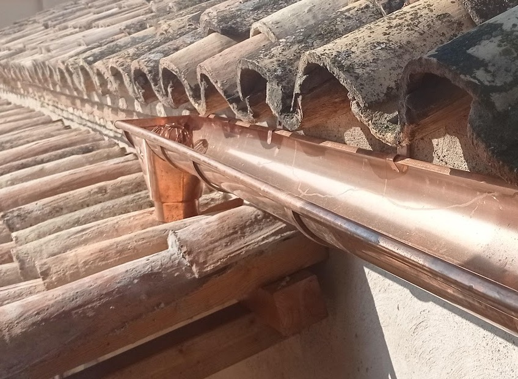

Diseñar con el agua empieza por observar de dónde llega, por dónde circula, dónde se almacena y para qué se necesita. La lluvia, el riego y las necesidades de plantas, animales y personas forman parte de esa misma mirada.

Cubrir el suelo, escoger plantas adaptadas y ajustar el riego son algunas de las decisiones que pueden mejorar su aprovechamiento. La recogida de lluvia y el almacenamiento tienen sentido cuando encajan con las condiciones y las necesidades del lugar.

En Torre Escribana podemos recorrer ejemplos de gestión del agua y conversar sobre cómo se relacionan con el paisaje de huerta de Montañana.

<figure class="ficha-foto"></figure>

<a href="{{ '/visitas/' | relative_url }}" class="btn-te">Descúbrelo en una visita</a>

