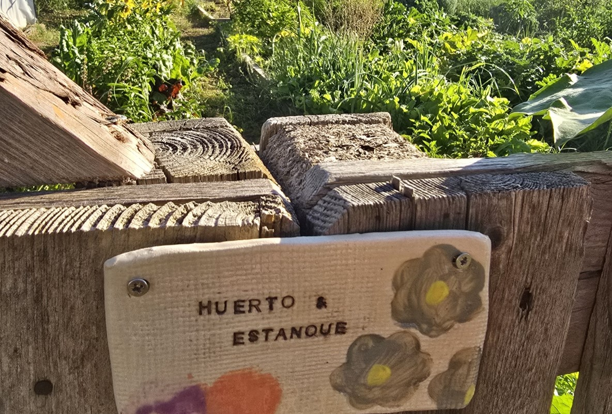

El huerto es un lugar para producir alimentos y aprender de las estaciones. Sembrar, observar el crecimiento y cosechar nos acerca al tiempo y los cuidados que hay detrás de lo que comemos.

En permacultura se presta atención al suelo, a la diversidad de cultivos y a la relación con el agua y los seres vivos. El compost, los acolchados o las asociaciones de plantas son recursos que se valoran según las necesidades de cada huerto.

La visita permite conocer qué está creciendo en ese momento y compartir preguntas sobre cultivo y cuidado del suelo. Cada estación ofrece un recorrido diferente.

<figure class="ficha-foto"></figure>

<a href="{{ '/visitas/' | relative_url }}" class="btn-te">Descúbrelo en una visita</a>

