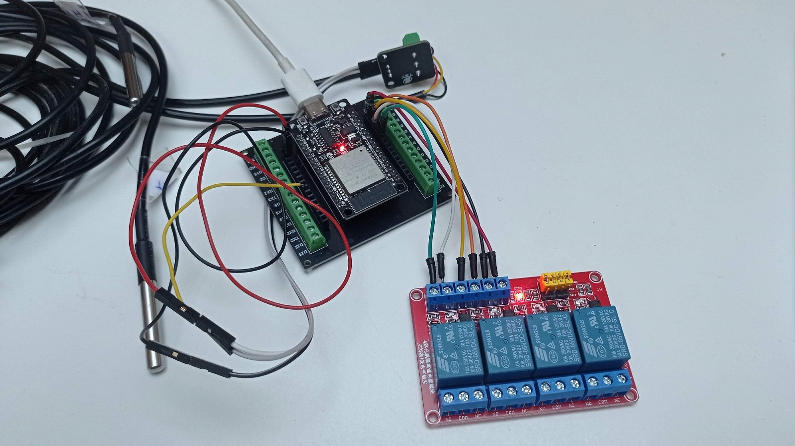

Una tecnología es apropiada cuando responde a una necesidad concreta y se puede comprender, mantener y reparar con los medios disponibles. Puede ser una herramienta sencilla, una solución constructiva o un dispositivo electrónico.

En un diseño permacultural interesa valorar su consumo de recursos, su utilidad y la dependencia que genera. Automatizar algunas tareas puede ayudar, siempre que el sistema siga siendo comprensible y permita intervenir cuando haga falta.

En las visitas compartimos ejemplos y preguntas sobre el papel de la tecnología en la vida cotidiana de una finca.

<figure class="ficha-foto"></figure>

<a href="{{ '/visitas/' | relative_url }}" class="btn-te">Descúbrelo en una visita</a>

