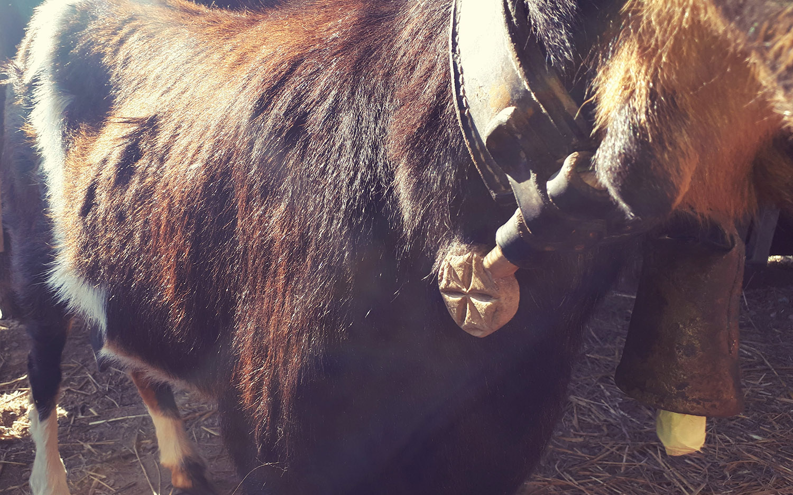

Los rumiantes pueden aprovechar ciertos recursos vegetales y forman parte de muchos paisajes rurales. Su presencia exige alimento adecuado, agua, refugio, atención sanitaria y un manejo que respete sus necesidades.

Su relación con el terreno debe planificarse: un acceso sin control puede dañar árboles o compactar el suelo. Observar dónde, cuándo y durante cuánto tiempo permanecen en cada zona ayuda a equilibrar sus cuidados y los de la vegetación.

Conocer a los animales durante una visita permite hablar de estas relaciones y del trabajo cotidiano que implica cuidarlos.

<figure class="ficha-foto"></figure>

<a href="{{ '/visitas/' | relative_url }}" class="btn-te">Descúbrelo en una visita</a>

