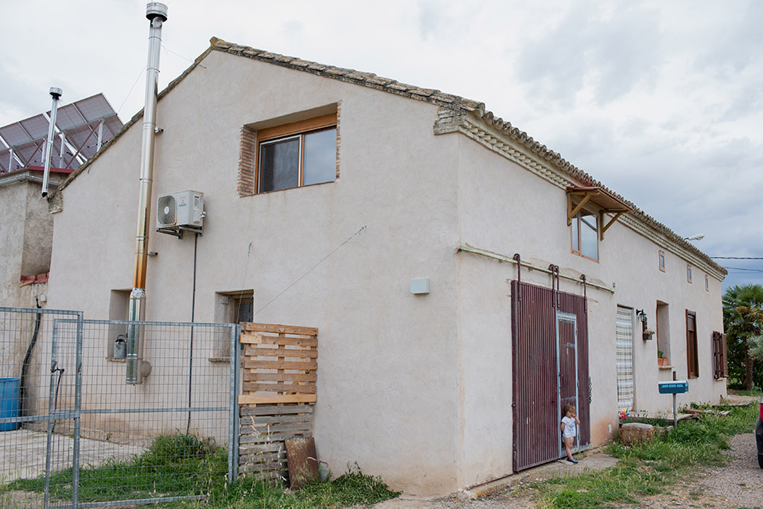

La vivienda es una parte central del diseño: un lugar para descansar, convivir y cubrir necesidades cotidianas. Su orientación, sus materiales y su relación con los espacios exteriores influyen en cómo se habita.

La construcción con tierra y los revestimientos naturales permiten trabajar con materiales cercanos y técnicas que requieren conocer su comportamiento. El confort depende del conjunto: protección frente al agua, aislamiento, ventilación, sombra y mantenimiento.

La casa de adobe de Torre Escribana forma parte de ese aprendizaje. En las visitas compartimos su historia y algunas decisiones de rehabilitación, respetando siempre los espacios de vida familiar.

<figure class="ficha-foto"></figure>

<a href="{{ '/visitas/' | relative_url }}" class="btn-te">Descúbrelo en una visita</a>

