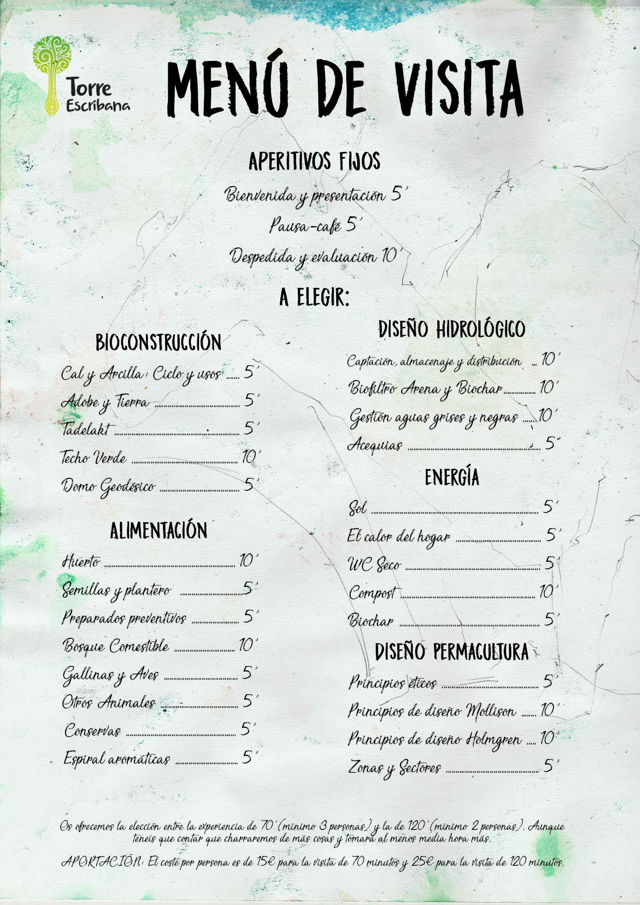

Descubrir todos los elementos de Torre Escribana es imposible en una sola visita. Por eso te proponemos elegir los temas que más te interesen de nuestro menú y crear tu propio recorrido: agua, suelo, animales, bioconstrucción y otras formas de aplicar la permacultura.

  
<strong>70 minutos:</strong> 15 € por persona, con un mínimo de 3 personas.

  
<strong>120 minutos:</strong> 25 € por persona, con un mínimo de 2 personas.

  
Cuenta con algo de margen: seguro que pillamos capazo y la experiencia se alarga un poco.

Las visitas ya están disponibles. Puedes consultar las opciones y realizar la reserva en la tienda de Permacultura Aragón.

  <a href="https://permaculturaaragon.org/producto/visita-a-torre-escribana/" class="btn-te">Reservar visita</a>

## Prepara tu recorrido

  <a href="{{ '/assets/img/visitas/menu.jpg' | relative_url }}" download="menu-torre-escribana.jpg" class="btn-te btn-te--outline">Descargar menú de la visita</a>

Formamos parte de [El Camino ESS](https://elcaminoess.com/), una propuesta de experiencias vinculadas a la economía social y solidaria. Puedes conocer también [nuestra experiencia en su web](https://elcaminoess.com/itinerario/permacultureando-a-tu-aire/).

Torre Escribana es también nuestro hogar. Las visitas se realizan siempre con reserva previa.

