<section class="page-section page-scouts">
  

    <!-- Intro -->
    

      En Torre Escribana os espera una experiencia scout de verdad: <strong>naturaleza, equipo y manos a la obra</strong>.
      Aquí se viene a convivir, explorar, aprender haciendo y llevarse ideas que luego se notan en la sección.
    

    

      Estamos <strong>muy cerca de Zaragoza</strong>, pero en cuanto entráis cambia el ritmo:
      bosque, huerto, animales y espacio para dinámicas. Vosotros traéis la sección; nosotros ponemos el lugar,
      los materiales y, si queréis, <strong>acompañamiento</strong> para que todo fluya.
    

    

      <a class="btn-te" href="#formulario">Pide más información</a>
      <a class="btn-te btn-te--outline" href="/contacto/" style="margin-left:10px;">Contacto</a>
    

    <!-- Bloque actividades -->
    <h2 style="text-align:center; margin-top: 8px;">Modalidades y actividades posibles</h2>
    

      Elegís formato y combinamos actividades según edades, temporada y objetivos de la sección.
    

    

      <!-- Excursiones -->
      <article class="card-design">
        

          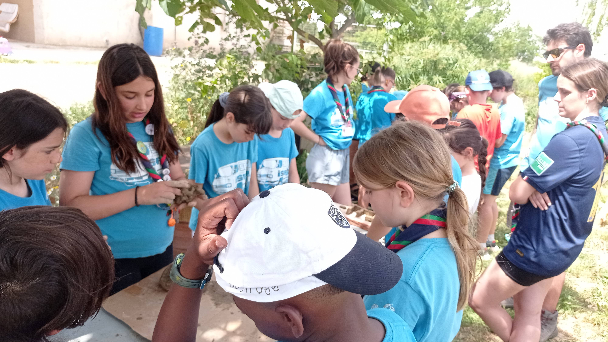
        

        

          <h3>Excursiones de día</h3>
          

            Jornada completa sin pernocta.
            <strong>Accesible andando desde parada urbana</strong> y con opción de ruta + dinámica + taller breve.
          

          <ul>
            <li>Recorrido interpretativo: huerto, bosque, agua, fauna</li>
            <li>Juegos cooperativos / rastreo / orientación</li>
           
          </ul>
        

      </article>

      <!-- Acampadas -->
      <article class="card-design">
        

          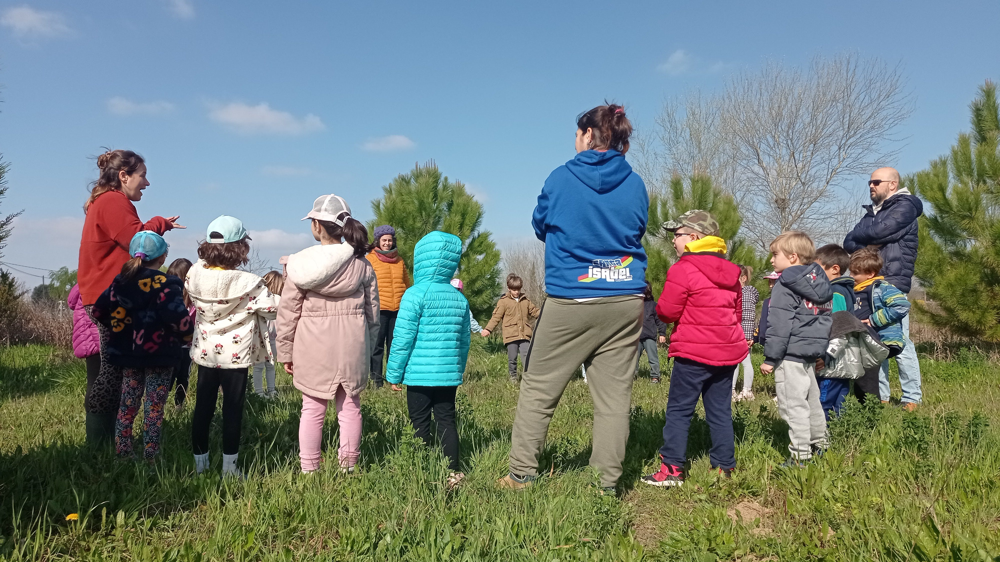
        

        

          <h3>Acampadas de fin de semana</h3>
          

            Para una sección que quiera <strong>vivencia completa</strong>: montar campamento, cocinar,
            cuidar el espacio y participar en actividades con más profundidad.
          

          <ul>
            <li>Formato 1–2 noches</li>
            <li>Posibilidad de <strong>servicio</strong> (proyecto útil y real)</li>
            <li>Opción de cocina en horno de leña</li>
          </ul>
        

      </article>

      <!-- Alquiler casa -->
      <article class="card-design">
        

          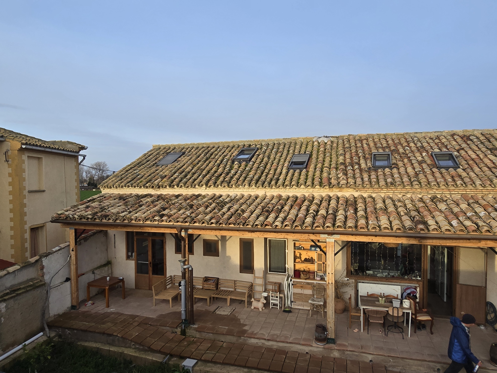
        

        

          <h3>Alquiler de casa</h3>
          

            Opción perfecta para <strong>secciones mayores en invierno</strong> o para
            <strong>reuniones de Kraal</strong> con calma, planificación y convivencia.
          

          <ul>
            <li>Con todos los servicios</li>
            <li>Espacios para reunión + exterior para dinámicas</li>
            <li>Ideal para formaciones internas o fin de semana de planificación</li>
          </ul>
        

      </article>

      <!-- Talleres -->
      <article class="card-design">
        

          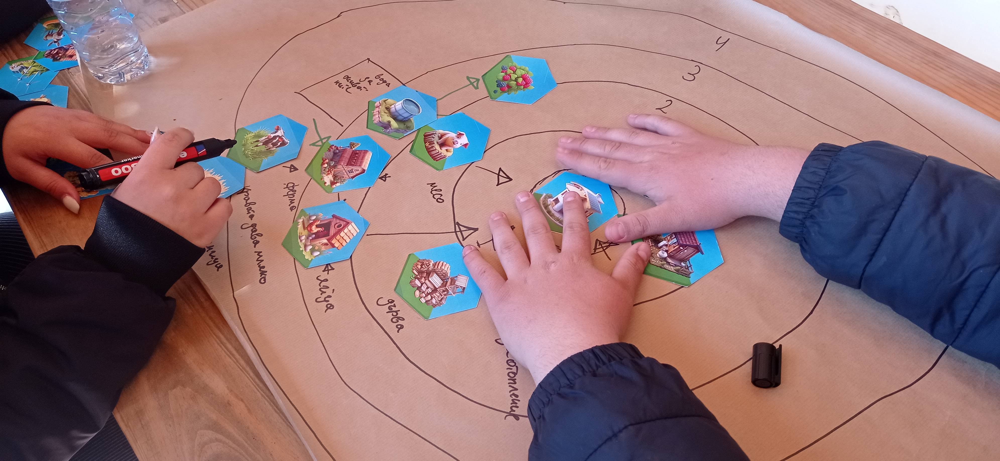
        

        

          <h3>Talleres para ampliar la estancia</h3>

          <ul>
            <li>Bioconstrucción (barro/adobe/madera, según temporada)</li>
            <li>Huerto y soberanía alimentaria</li>
            <li>Animales y cuidados básicos</li>
            <li>Economía circular / residuos / agua (según objetivos)</li>
          </ul>
        

      </article>

    

     
     

    <!-- CTA final: SOLO Contacto (sin "Pedir disponibilidad") -->
    <section class="cita-inspiracion" style="margin-top: 28px;">
      

        Para proponerte una experiencia cerrada, cuéntanos <strong>edades</strong>, <strong>nº de participantes</strong> y
        <strong>fechas</strong>, y si queréis <strong>día</strong>, <strong>acampada</strong> o <strong>casa</strong>.
      

      

        <a class="btn-te btn-te--outline" href="/contacto/">Contacto</a>
      

    </section>

  

</section>

<!-- Estilos locales SOLO para esta página -->

 

<!-- Galería de fotos (antes del formulario) -->
<section class="page-section page-scouts-gallery" id="galeria">
  

    <h2 style="text-align:center; margin: 0 0 10px;">Galería</h2>
    

      Unas cuantas fotos para que os hagáis una idea del lugar y los espacios.
    

    

      <figure class="photo-item">
        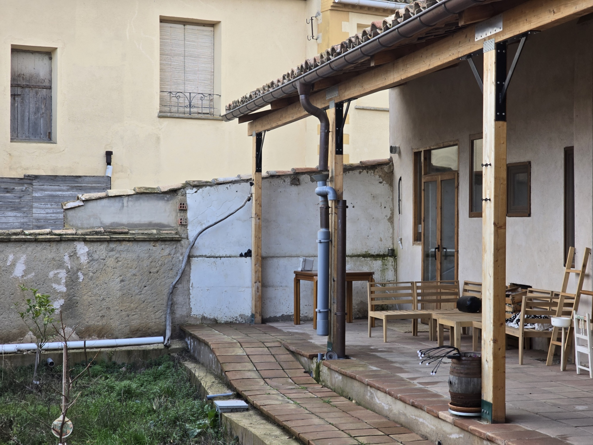
      </figure>
      <figure class="photo-item">
        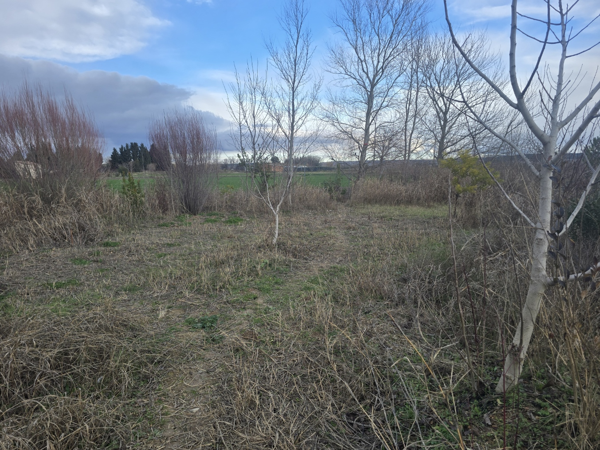
      </figure>
      <figure class="photo-item">
        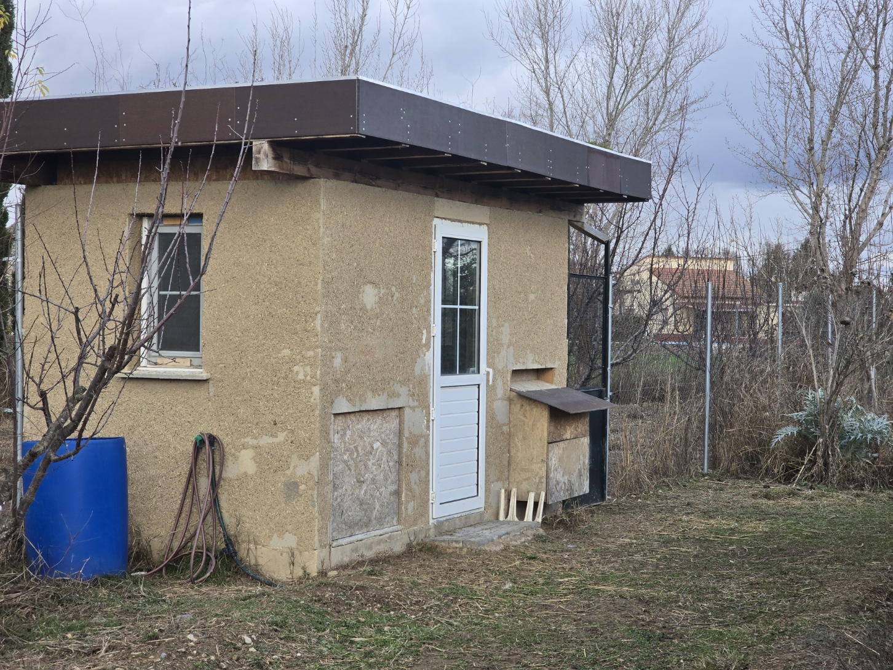
      </figure>
      <figure class="photo-item">
        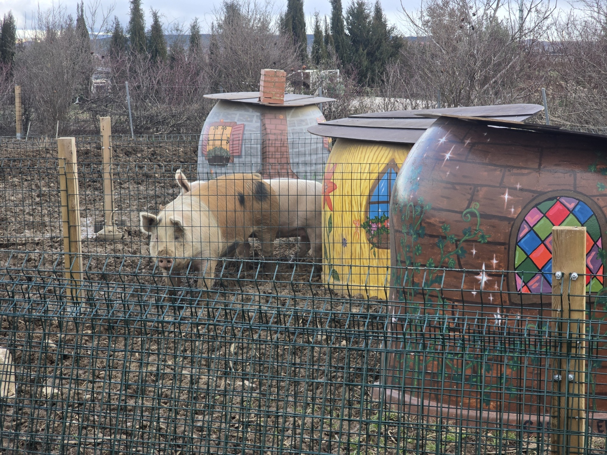
      </figure>
      <figure class="photo-item">
        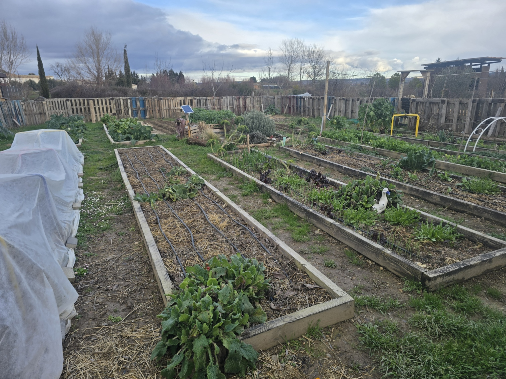
      </figure>
      <figure class="photo-item">
        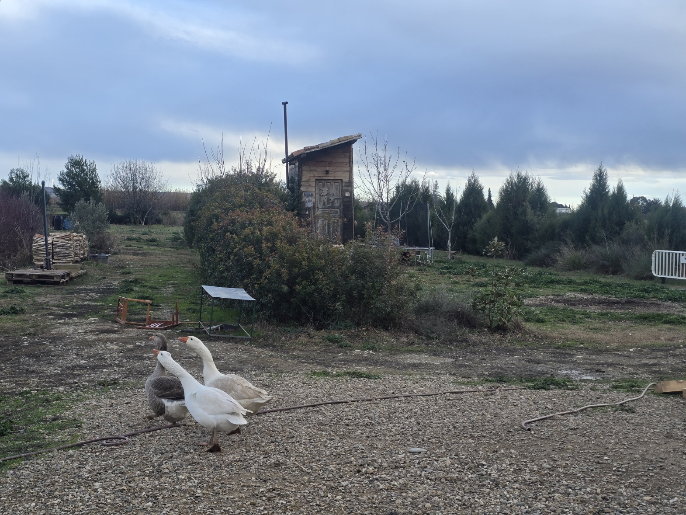
      </figure>
      <figure class="photo-item">
        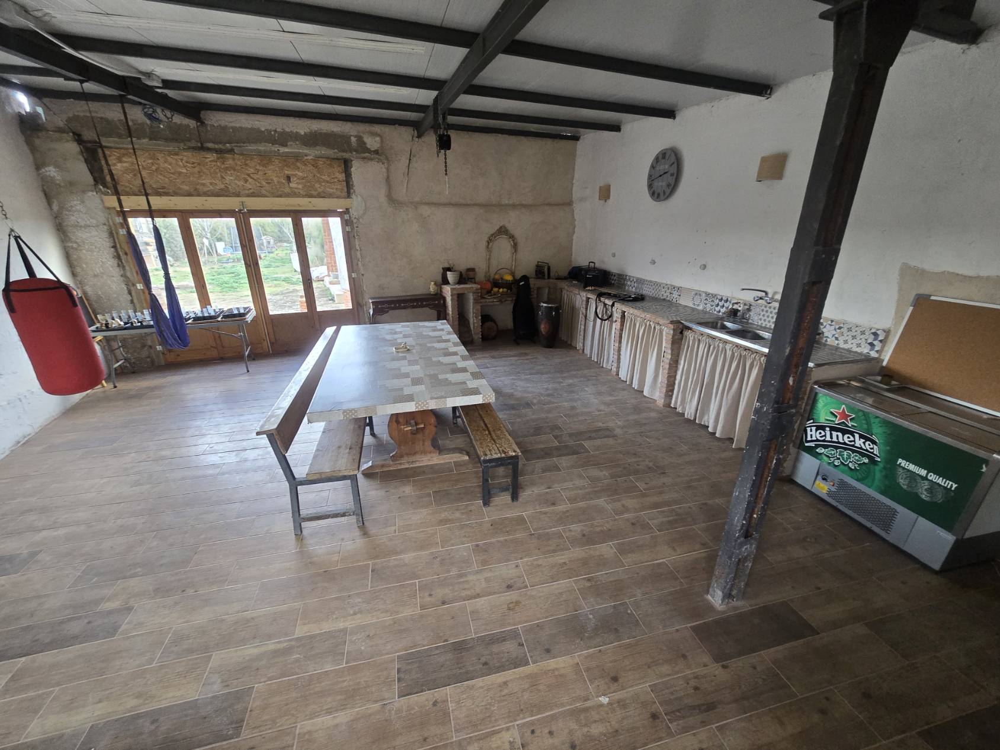
      </figure>
      <figure class="photo-item">
        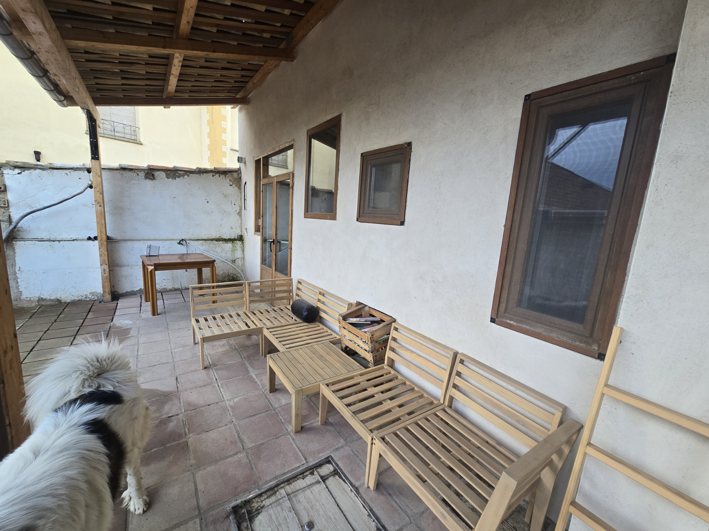
      </figure>
      <figure class="photo-item">
        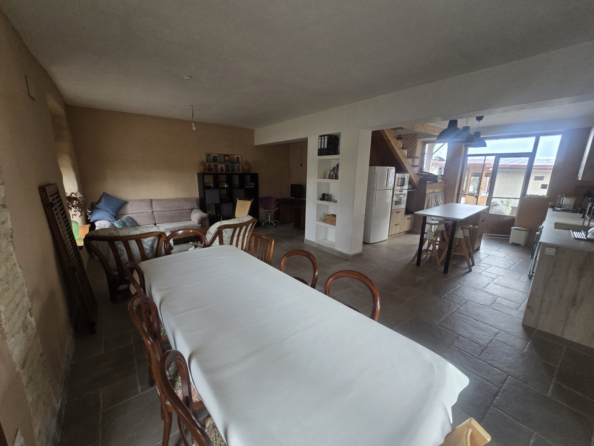
      </figure>
      <figure class="photo-item">
        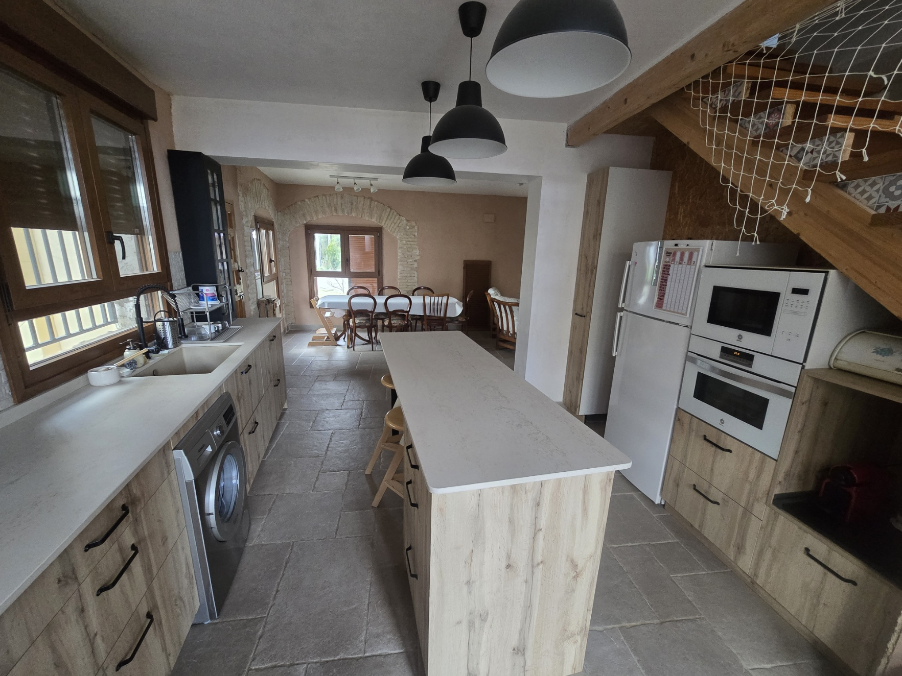
      </figure>
      <figure class="photo-item">
        
      </figure>
      <figure class="photo-item">
        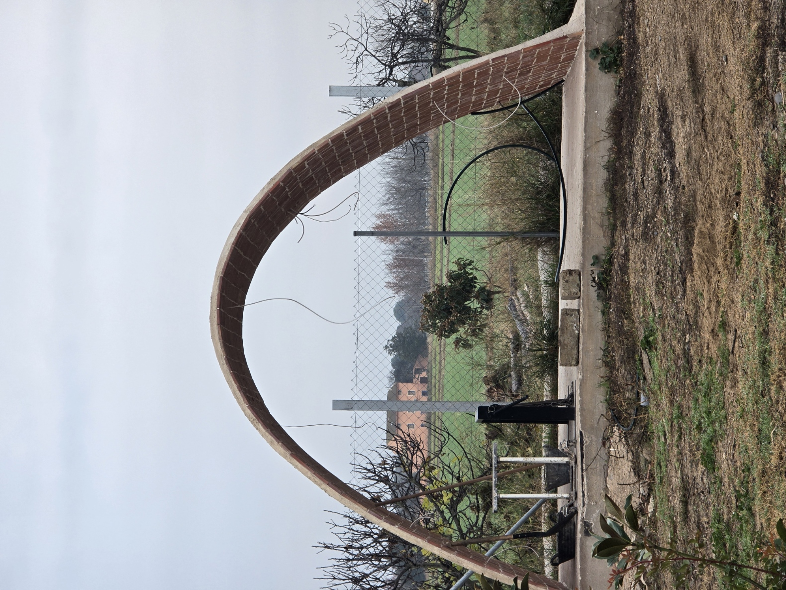
      </figure>

    

  

</section>

<!-- Formulario -->
<section class="page-section" id="formulario">
  

   
    <h2 style="text-align:center; margin: 0 0 10px;">Pide más información</h2>
    

      Rellenad el formulario y en <strong>24–48h</strong> os respondemos con propuesta y disponibilidad.
    

    <iframe
      src="https://docs.google.com/forms/d/e/1FAIpQLSerCJWv7CPSIce97gVE9xiEhfUPLI7iC0me3cV32FIzgUBLig/viewform?embedded=true"
      width="100%" height="1700" frameborder="0" marginheight="0" marginwidth="0"
      style="background:#fff; border-radius:18px; box-shadow: 0 18px 40px rgba(0,0,0,0.10);"
    > Cargando… </iframe>
  

</section>

