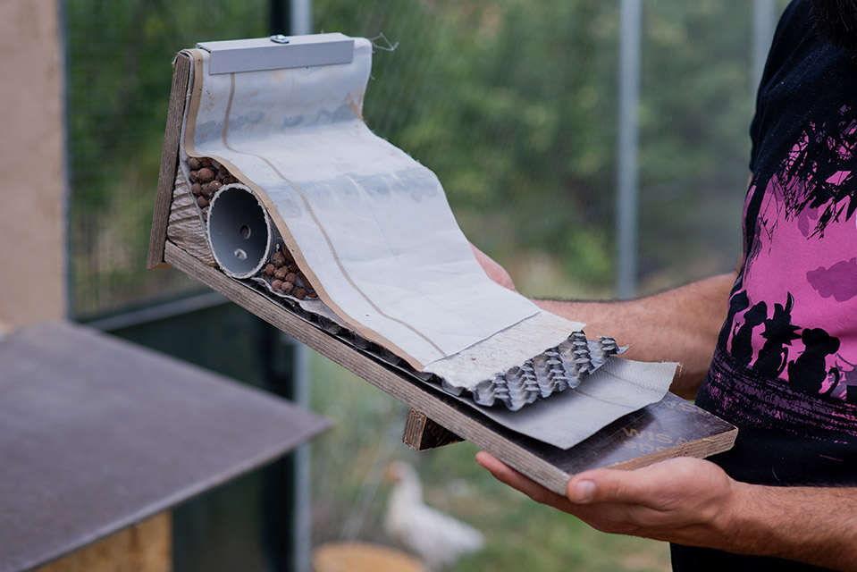

Las jornadas colaborativas, los talleres y los cursos son otra forma de conocer Torre Escribana. Compartimos conocimientos y experiencias alrededor de la permacultura, el suelo, la bioconstrucción y los cuidados de la finca.

Consulta las próximas fechas en la agenda. Si todavía no hay actividades programadas, puedes recorrer las realizadas o seguir nuestro canal de Telegram para recibir novedades.

  <a href="{{ '/agenda/' | relative_url }}" class="btn-te">Ver próximas actividades</a>
  <a href="https://t.me/torreescribana/" class="btn-te btn-te--outline">Seguir en Telegram</a>

